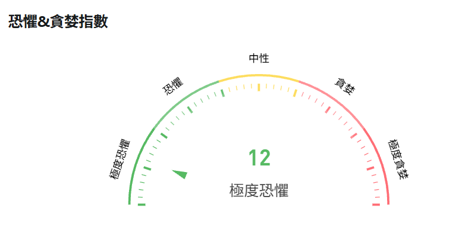
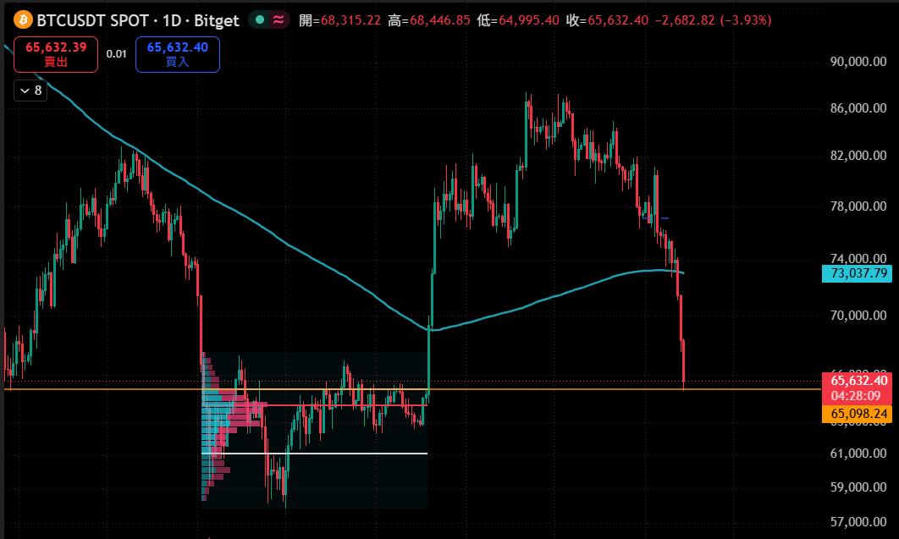

Market sentiment has dropped to a recent low today. Prices keep sliding day after day. The panic never arrives as fast as it does with a sudden wick down, so it feels like being a frog in slowly heating water.

This is the current Bitcoin price chart. Just when everyone believes the bull market is here, the big players make their move. In a market this speculative, what they do is shake retail traders out of their positions again and again. The exchanges make money, and the big players get to pick up coins sold at a loss.

I am holding a long-term long position in Bitcoin. The price is now close to my liquidation price of 61,450. I used to think that level could never be reached. Now it is within sight. It has taught me a valuable lesson: always respect the market, always manage your capital, and always have a stop-loss plan. Do not open a position and leave it there with no idea what comes next. Planning the next step is what matters most.
