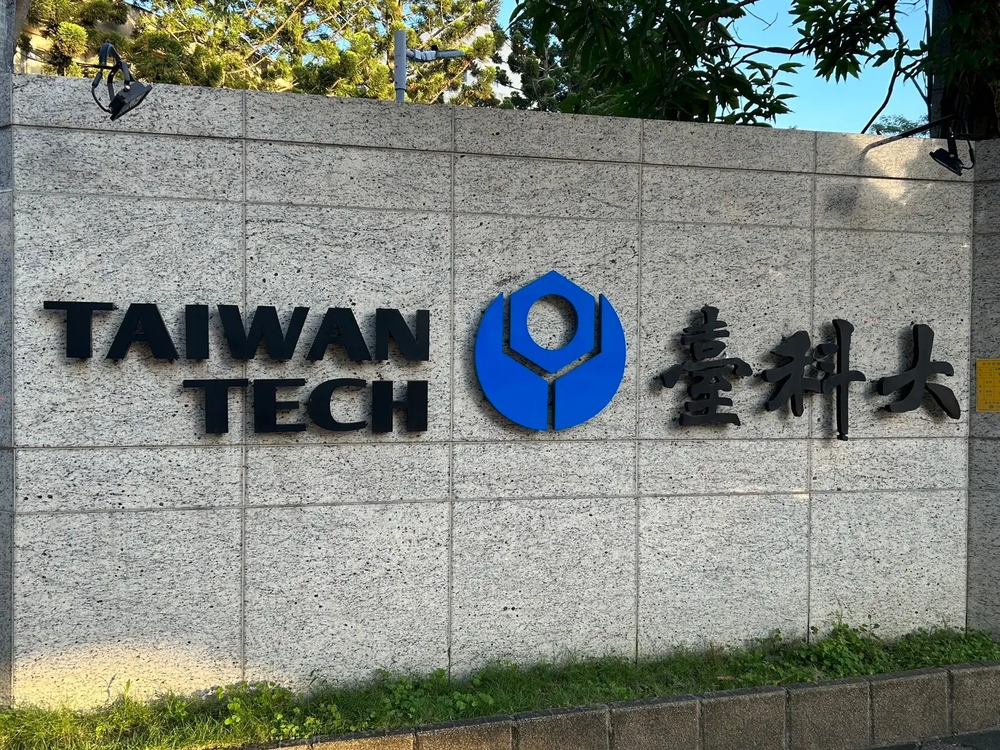
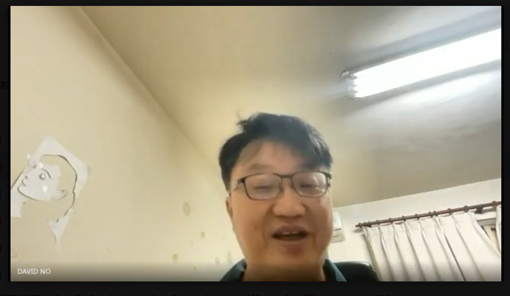

I was lucky to get an interview for the master's program in Electronic Engineering (Group A) at Taiwan Tech. Preparing for it taught me a lot.

When my dad heard about the interview, he started helping me prepare right away. He has helped me with many things since I was little, like reading-aloud and speech contests. We did three online practice runs before the interview, and they helped a lot.

At first, my answers had no structure. I said whatever came to mind, so my answers were vague and drifted off topic. That is what I worked on.

Later, my answers followed the same structure: motivation, process, and what I gained. This was my main way to answer, and it worked well. Since the interview was short, I later cut it down to just process and what I gained.

It was much better than my first practice, and it was also a good review of what I did in college. Thanks again to my dad for all his help.

The interview had two parts. The first was questions. The second was a C programming test on a computer. I was quite nervous, but luckily I ran into someone from Taipei Tech, which took off a lot of pressure.

Questions in the first part:

1. Professor Juan: Did you go to a regular high school or a vocational high school?
2. Professor Juan: How did you prepare for the TOEIC?
3. Professor Sung: Which schools did you apply to?
4. Professor Sung: Why only Taiwan Tech and Taipei Tech? Professor Sung: Can you face your own conscience? (laughs)
5. Professor Juan: Were all three of your overseas programs funded?
6. Professor Juan: Do you enjoy overseas activities like these?
7. Professor Juan: So you have no trouble listening, speaking, and writing proposals in English?

Questions in the second part:

1. Find the smallest value in an array
2. Convert a number to binary and count how many 0s it has

After the interview I was quite confused, because they asked nothing about my field or my project. I could not tell if that was very good or very bad. I hope it was good.

Afterward I had a pork cutlet rice bowl with bot6. It was pretty good.
