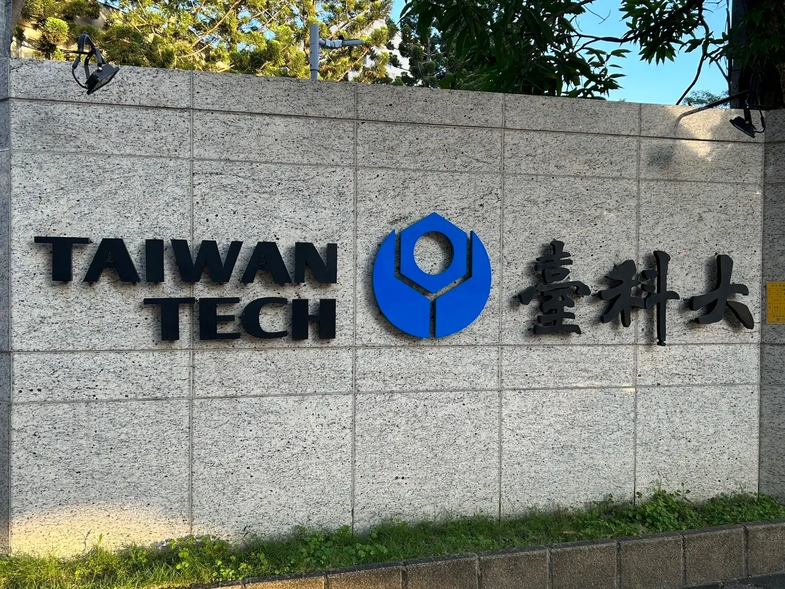
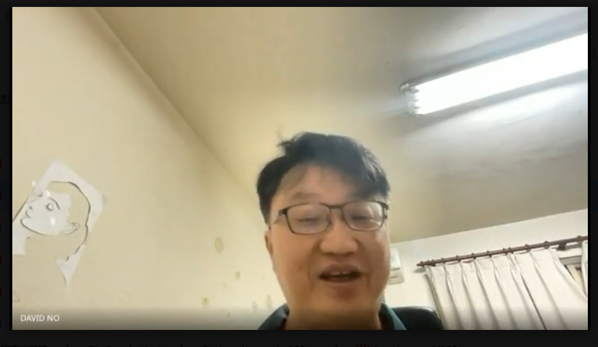

這次有榮幸獲得面試台科電子甲組碩士班的機會，在準備的面試過程中，也頗有心得跟收穫。

老爸知道我要面試後，二話不說著手幫我準備面試，其實從小到大，我老爸也是幫了我許多忙，像是朗讀比賽、演講比賽等等。面試前總共線上練習了三次，我覺得對於面試過程幫助許多。

一開始被問問題時，我覺得我講話沒有甚麼架構或是脈絡，比較像是腦中想到甚麼就說甚麼，這樣會回答不精準及跑題，所以就從這方面去著手。

到後面講話時，架構跟脈絡都差不多，比如:動機、過程、收穫，這是我最主要用來回答的脈絡，算是蠻好用的。不過用到後面，考慮面試時間較短，最終改成過程及收穫就好了。

我認為比一開始練習還好很多，也算是重新複習了大學做過的事情，再次感謝我老爸的大力相助。

最終面試分為兩關，第一關為問問題，第二關為上機考C。本來蠻緊張的，幸好有碰到北科的人，算是緩解了不少壓力。

第一關的問題:

1. 阮:你是高中生還是高職生?
2. 阮:你多益是怎麼準備的?
3. 宋:你有報名哪些學校?
4. 宋:為甚麼只報名台科跟北科? 宋教授:你對得起你的良心嗎?哈哈
5. 阮:你這三個出國的計畫都是有補助的嗎?
6. 阮:你很樂忠於類似這種出國的活動嗎?
7. 阮:那你用英文聽跟說，還有寫計畫是沒問題的嗎?

第二關的問題:

1. 陣列找最小值
2. 將數字轉為二進治後，數有幾個0

面完可以說滿頭霧水，因為沒有問任何專業問題及專題方面，不知道是大好還是大壞，希望是前者。

面完跟bot6吃了豬排飯，還不錯吃。
