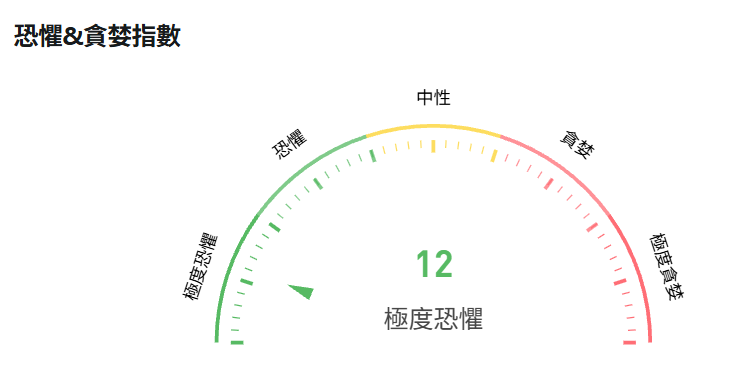
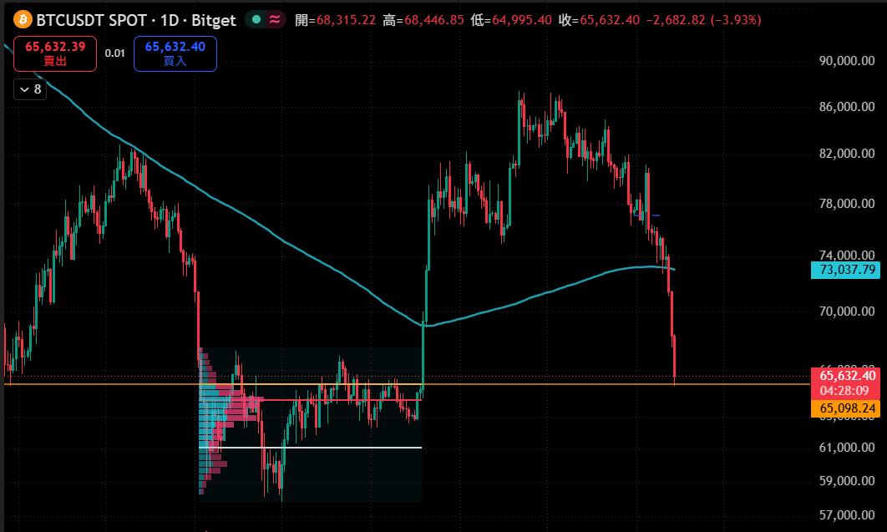

今天的市場氛圍來到近期低點，不斷地陰跌，好像恐慌程度就沒有插針來的快，讓人有溫水煮青蛙的錯覺。

這是目前比特幣的價格走勢，當大家都以為牛市來了，莊家就要搞事了，在這個極度投機的市場，莊家要做的就是不斷地清洗散戶的籌碼，不只交易所可以賺錢，更可以撿帶血的籌碼。

目前我持有比特幣的長線多單，已經快到我的強平價61450了，我曾經以為這是不可能觸碰到的底線，現在卻近在咫尺，讓我學到了寶貴的一課，永遠要對市場保持敬畏，永遠要做好資金管理，永遠要做好止損的計畫，而不是當個無頭蒼蠅，開了倉就放著，擬定下一步的策略才是最重要的。

