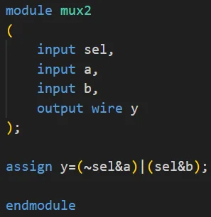
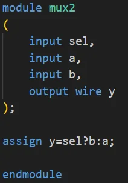
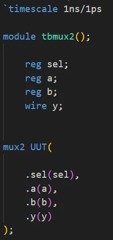
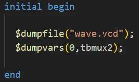
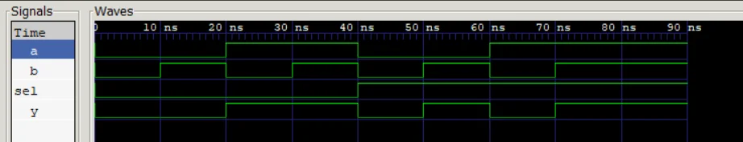

今天要來寫簡單的2選1多工器。

這是兩種RTL的寫法，一種直接用邏輯閘表示，另一種化簡後用條件式。

這是testbench，最上面是時間單位/時間精度，#20就是以1nS為單位\*20。

第二段是宣告一個測試電路板，外面不接任何東西，所以後面是();，然後他要給剛剛寫的RTL輸入訊號跟接輸出訊號看結果，所以用reg給值，wire接起來看訊號。

第三段是將測試版跟原電路接起來，.sel(sel)是在說，將原電路接給測試版。

最後輸出一個vcd波形檔，命名為wave，然後檢測範圍從0到tbmux2，也就是全部。

最後成功輸出一個2對一多工器。

注意事項：打reg時，真的會有一個記憶元件被做出來嗎？

Ａ：不一定，要看寫法。
1.當你打always(posedge clk)，會有邊緣觸發，所以會有正反器。
2.當你打always(\*)，每個情況都寫出來，純組合邏輯，只有邏輯閘，不記東西。
3.當你打always(\*)，少寫幾種情況，會有latch被產出。
