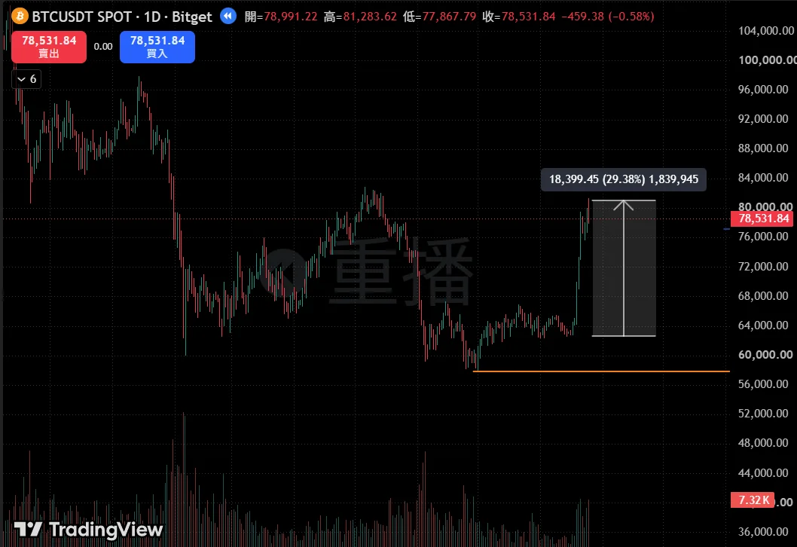
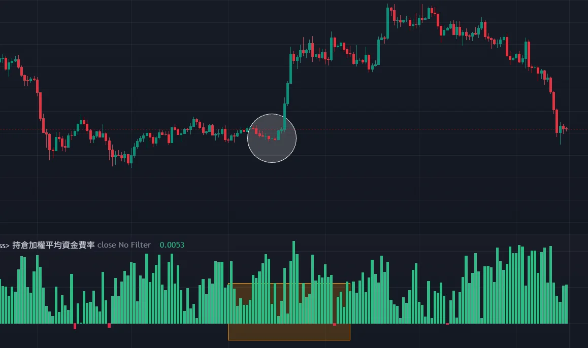
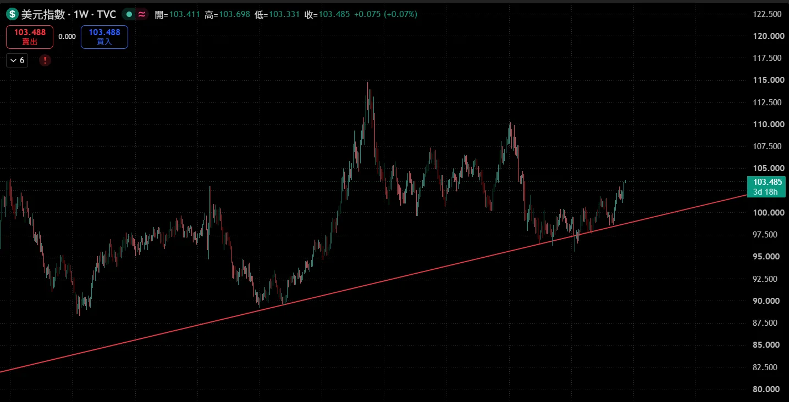
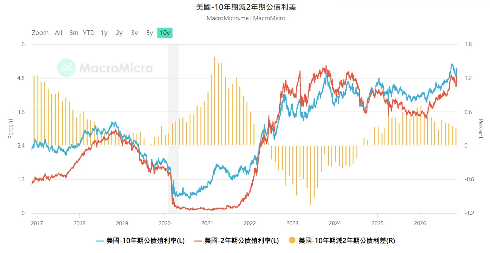
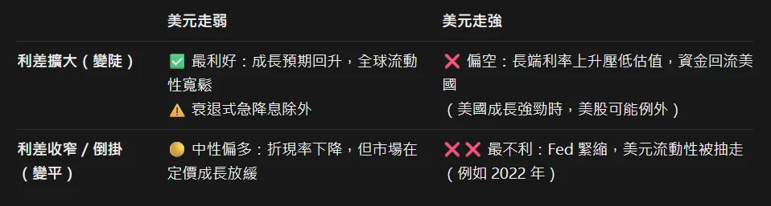

今天想來覆盤比特幣為甚麼會走成這樣，中間的黑天鵝我們都忽略不計(幣安被盜63億、黃仁勳將公司利益優先於美國國家安全等等)，消息面雖然會影響短期走勢，但長期不會影響，所以也不至於會走的那麼醜，這是我個人的淺見。

在8/17，比特幣開啟大漲幅，這時候市場還是矇逼的，當大家都在看4、5萬時，沒人出手，所以莊家決定不帶大家上車，況且這時候大家還看空，資金費率偏負，開啟大多頭的爆量上漲，完全是牛市初期的徵兆。

這是三個月後的走勢，有人可以想到嗎?

今天想看的角度是，不管有沒有黑天鵝，或許比特幣都注定該走成這樣，當然這只是我的非事實推測，但我想用宏觀經濟的角度去看這件事。

美元指數。

美國10年期減2年期公債利差。

大要就是，美元走強，大家去投資美國市場所需成本變高。

公債利差，10年大家看的是美國經濟能不能穩定成長，還不還的出錢。2年大家看的是利率及通膨走勢，利率低就代表，大家預期市場寬鬆，寧願拿著錢去投資市場，利率高就代表，大家預期流動性緊縮，寧願買公債也不投資。

所以如果利差越大，代表市場偏好風險市場，反之亦然，並且可以看出，我們目前是利差越來越小，不利好風險市場。

目前我們偏向第四種，就宏寬經濟來看，是最不利於風險資產的，所以或許比特幣根本沒來過牛市，這次教訓中，我學到即使符合過去的走勢，但還是要就大方面去看，雖然不一定每次都這樣，但至少可以給我們一個警惕心，而不是當一個死多頭。

每次都要從中獲取教訓，之後才不會重蹈覆轍，我也在這次認知到，在期貨市場中，賺錢的人根本只是少數，或許我還年輕，風險偏好可以大一點，但也是因為我這樣的想法，才一而再再而三的不斷虧錢，我現在應該做好我自己的本份，將剩餘的零用錢投入市場中就好了，費心神在上面還輸錢，得不償失，也讓我更清楚我未來該投資的方法及方向。
